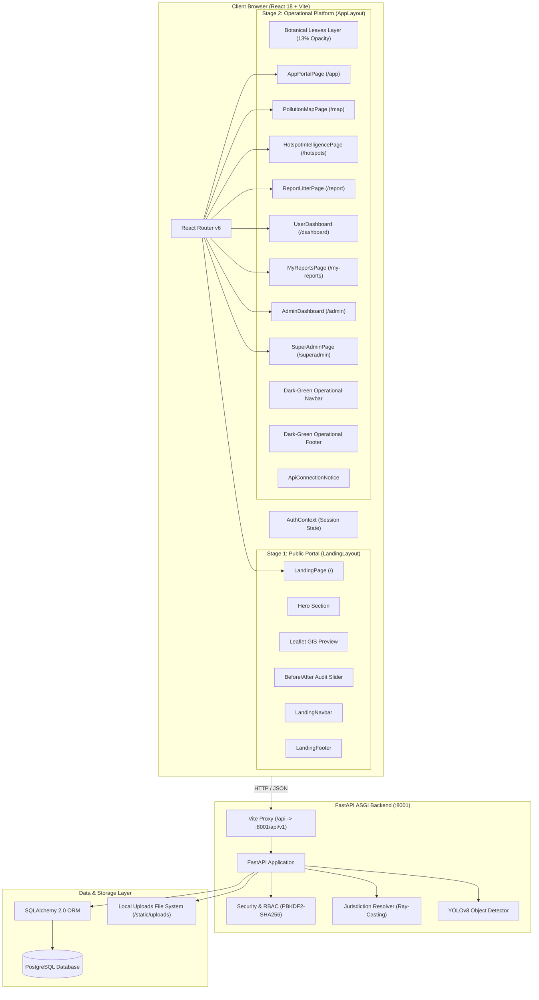
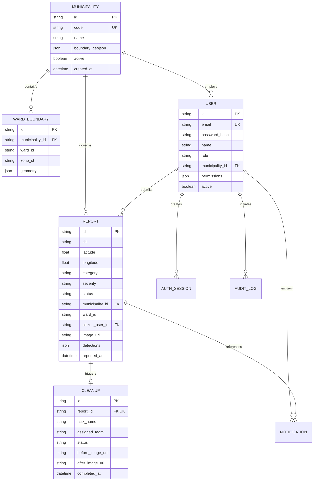

# Vasundhara AI — Architecture Specification

**Status:** Authoritative Baseline Architecture  
**Application Type:** Sovereign Municipal Environmental Intelligence & Civic Litter Monitoring Platform  
**Target Region:** Maharashtra Municipal Corporations (PMC, BMC, PCMC, TMC)  

---

## 1. Architectural Philosophy

Vasundhara AI is engineered on three core architectural principles:
1. **Two-Stage User Experience:** Clean separation between the public storytelling website (`/`) and the high-density operational intelligence platform (`/app`).
2. **Sovereign Municipal Isolation:** Multi-tenant territorial isolation ensuring each municipal corporation operates within its own administrative boundary without cross-tenant data leakage.
3. **Pure Software Intelligence:** High-efficiency geospatial analysis, crowdsourced validation, and computer vision classification without dependence on proprietary external hardware.

---

## 2. Component Hierarchy & Layout Structure

---

## 3. Frontend Architecture

### 3.1 Two-Stage Routing Topology
- **Stage 1 (Public Website at `/`):**
  - Layout: `src/layouts/LandingLayout.jsx`.
  - Content: Long-scrolling 12-section editorial portal (`src/components/landing/*`).
  - Style: Clean skin-beige background (`#FAF8F3`) with dark-green government headers and interactive demonstrations.
- **Stage 2 (Operational Intelligence Platform):**
  - Layout: `src/layouts/AppLayout.jsx`.
  - Base Styling: Atmospheric botanical leaves texture (`sidebar-botanical-vertical.jpg`) at 13% opacity positioned non-intrusively behind all application content (`pointer-events-none`).
  - Navigation: Luminous dark-green header with pulsing GIS telemetry strip and profile management.

### 3.2 Client Services
All client-server communication is structured through dedicated domain services:
- `apiClient.js`: Centralized fetch wrapper with Bearer token injection, `ApiError` standardization, and asset URL resolution.
- `authService.js`: Authentication, session verification, and role resolution.
- `reportService.js`: Citizen incident submission, spatial filtering, and incident detail fetching.
- `cleanupService.js`: Municipal cleanup dispatch, team scheduling, and before/after verification audits.
- `hotspotService.js`: Algorithmic hotspot calculation, priority rankings, and recurrence trends.
- `analyticsService.js`: Platform telemetry, ward resolution rates, and notification queues.
- `superAdminService.js`: Municipal boundary registration, administrative provisioning, and border resolution.

---

## 4. Backend Architecture

### 4.1 Route Modularization & Schema Validation
All routes are hosted under `/api/v1` in `backend/app/api.py`, validated via Pydantic schemas:
- **Public Routes:** `/public/reports`, `/public/hotspots`, `/public/metrics` (exclude private reporter identities, internal notes, and administrative contact leads).
- **Authenticated Citizen Routes:** `/reports`, `/reports/mine`, `/reports/{id}` (allow submission, personal tracking, and report cancellation).
- **Municipal Admin Routes:** `/reports`, `/cleanups`, `/admin/ward-stats`, `/admin/notifications`, `/reports/export.csv` (strictly filtered by `User.municipality_id`).
- **Super Admin Routes:** `/superadmin/municipalities`, `/superadmin/admins`, `/superadmin/reports/pending-jurisdiction`, `/superadmin/audit` (cross-platform governance).

### 4.2 Multi-Tenant Jurisdiction Engine
Territorial routing is handled by `backend/app/jurisdiction.py`:
1. When a report is submitted with `(latitude, longitude)`, the system evaluates all active municipal boundaries (`Municipality.boundary_geojson`).
2. Point-in-polygon containment uses the ray-casting algorithm.
3. If inside a polygon, the engine tests if the point is within 25 meters (`DEFAULT_BOUNDARY_MARGIN_METERS`) of an outer boundary edge. Borderline points are quarantined (`status="quarantined-boundary"`).
4. If clearly within a municipality, it queries ward boundaries (`WardBoundary.geometry`) to assign `ward_id` and `zone_id`.
5. If outside all registered municipalities, it is tagged `status="unresolved"` for manual triage.

### 4.3 Security & Role-Based Access Control (RBAC)
- **Password Hashing:** `PBKDF2-HMAC-SHA256` with 310,000 rounds.
- **Session Auth:** 36-byte cryptographically secure tokens stored hashed in `auth_sessions` with 12-hour expiration.
- **Dependency Inversion:** Route handlers enforce roles via FastAPI dependencies:
  - `current_user`: Any authenticated user.
  - `citizen_user`: Requires `role="citizen"`.
  - `municipal_admin_user`: Requires `role="municipal_admin"` and non-null `municipality_id`.
  - `super_admin_user`: Requires `role="super_admin"`.
  - `require_permission(perm)`: Verifies granular permissions array.

### 4.4 Computer Vision Subsystem (YOLOv8)
- `backend/app/vision.py` interfaces with Ultralytics YOLOv8.
- Uploaded incident photography is inspected for packaging, plastic bottles, hazardous drums, and bulk litter.
- Bounding boxes and confidence scores are stored in `Report.detections` as JSON, giving sanitation crews instant visual confirmation of waste density.

---

## 5. Persistent Data Model (SQLAlchemy)

