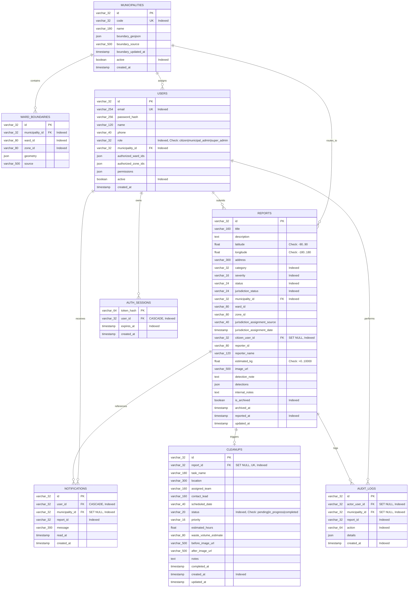

# Vasundhara AI — Production PostgreSQL Database Schema

---

## 1. Entity-Relationship Overview

---

## 2. Table Specifications & Indexes

### 2.1. `reports` (Pollution Incidents)
- **Primary Key:** `id` (VARCHAR(32))
- **Foreign Keys:**
  - `municipality_id` $\rightarrow$ `municipalities.id` (`ON DELETE SET NULL`)
  - `citizen_user_id` $\rightarrow$ `users.id` (`ON DELETE SET NULL`)
- **Indexes:**
  - `ix_reports_status` on `status` (B-Tree: fast filtering by open/resolved state)
  - `ix_reports_reported_at` on `reported_at` (B-Tree: sorting reports chronologically)
  - `ix_reports_coordinates` on `(latitude, longitude)` (Compound index for spatial bounding queries)
  - `ix_reports_municipality_ward` on `(municipality_id, ward_id)` (Compound index for tenant and ward dispatch filtering)
  - `ix_reports_jurisdiction_status` on `jurisdiction_status` (Filtering reports pending review)
  - `ix_reports_archived` on `is_archived` (Filtering active vs archived reports)
- **Check Constraints:**
  - `chk_report_latitude`: `latitude BETWEEN -90.0 AND 90.0`
  - `chk_report_longitude`: `longitude BETWEEN -180.0 AND 180.0`
  - `chk_report_estimated_kg`: `estimated_kg > 0 AND estimated_kg <= 10000`

### 2.2. `cleanups` (Municipal Remediation Workflows)
- **Primary Key:** `id` (VARCHAR(32))
- **Foreign Key:** `report_id` $\rightarrow$ `reports.id` (`ON DELETE SET NULL`)
  > [!IMPORTANT]
  > Using `ON DELETE SET NULL` ensures that deleting or archiving an incident report **never accidentally destroys municipal cleanup operational history**, crew dispatch records, or after-cleanup photo verifications.
- **Indexes:**
  - `ix_cleanups_status` on `status` (B-Tree: pending, in_progress, completed)
  - `ix_cleanups_created_at` on `created_at` (B-Tree: task dispatch chronological ordering)
- **Check Constraints:**
  - `chk_cleanup_status`: `status IN ('pending', 'in_progress', 'completed')`

### 2.3. `users` (Multi-Role Authentication)
- **Primary Key:** `id` (VARCHAR(32))
- **Unique Indexes:** `ix_users_email` on `email` (Case-insensitive unique constraint)
- **Foreign Key:** `municipality_id` $\rightarrow$ `municipalities.id` (`ON DELETE SET NULL`)
- **Check Constraints:**
  - `chk_user_role`: `role IN ('citizen', 'municipal_admin', 'super_admin')`

### 2.4. `municipalities` & `ward_boundaries`
- **Primary Key:** `id` (VARCHAR(32))
- **Unique Index:** `ix_municipalities_code` on `code` (e.g. `PMC`, `PCMC`, `BMC`)
- **Ward Boundaries:** Cascades `ON DELETE CASCADE` when parent municipality is removed.
